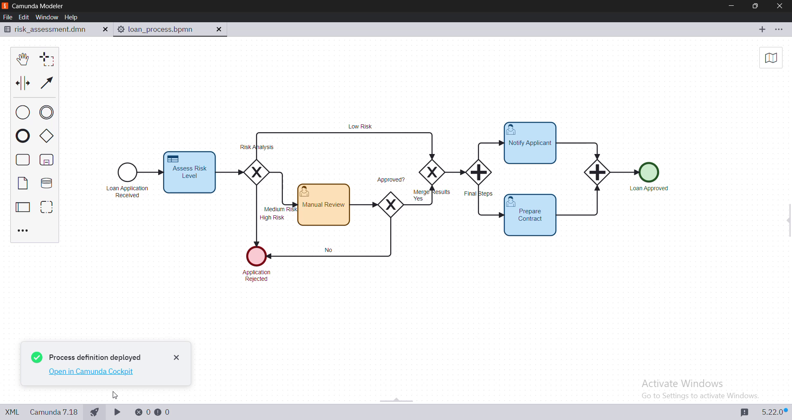

# 🏦 Loan Approval Automation – Camunda 7.18 (BPMN + DMN)

Design, automation, execution and monitoring of a bank loan approval workflow with **Camunda Platform 7.18**, **BPMN** and **DMN**.

## Idea
A loan application is evaluated automatically from two inputs, the **salary** and the **requested amount**. A DMN decision table returns the risk level, and an XOR gateway routes the case:

| Risk | Handling |
|---|---|
| Low | Automatic approval |
| Medium | Manual review by a human task |
| High | Automatic rejection |

After approval, an AND gateway runs two tasks in parallel: **notify the applicant** and **prepare the contract**.

## What it shows
- Executable BPMN model with user tasks, XOR and AND gateways
- Business rules separated from the flow in a DMN table
- Deployment from Camunda Modeler, task handling in Tasklist, monitoring in Cockpit (variables, incidents)
- Three tested scenarios: automatic approval, manual review, automatic rejection

## Files
- `docs/rapport-loan-approval.pdf`: full project report (French)
- `demo/deploy-process.mp4`: deploying the process from Camunda Modeler
- `demo/execution-demo.mp4`: running instances in Tasklist and Cockpit

## Authors
Eya Ibn Abdelhedi & Amira Midani, supervised by Lamia Al Abed – ISG Tunis, 2025/2026.
